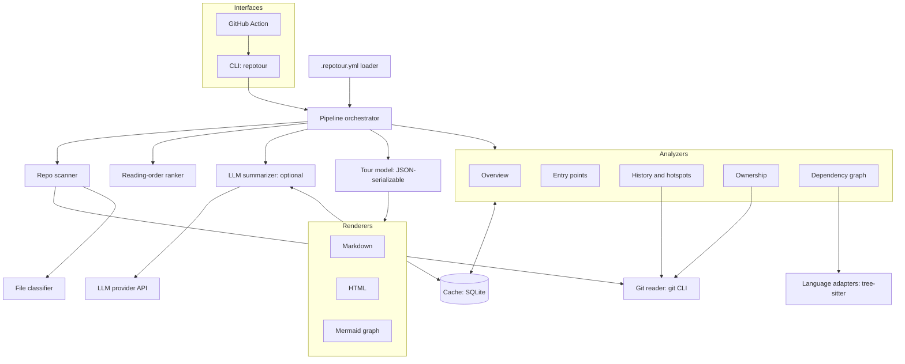

# Repotour architecture

Companion to `vision.md`. This describes how Repotour is built: components, boundaries, data contracts, and the rules every change must follow. When this file and the code disagree, fix one of them.

## Tech choices

- **Language:** Python 3.11+
- **CLI:** Typer
- **Platforms:** Linux, macOS, Windows (all in CI); git 2.30+ checked at startup
- **Git access:** the `git` CLI via subprocess (`git log --numstat`, `git blame --porcelain`), which handles `.mailmap`, renames, and `--ignore-revs-file` natively
- **Parsing:** tree-sitter (`py-tree-sitter` plus grammars for Python, JavaScript/TypeScript, Go)
- **Templates:** Jinja2 for Markdown and HTML output
- **Cache:** SQLite file in `<git common dir>/repotour-cache/` (safe to delete; see `docs/adr/0004`)
- **LLM summaries:** one adapter for any OpenAI-compatible chat API (Ollama, LM Studio, llama.cpp, Groq, OpenRouter, Gemini, OpenAI, …), installed as an optional extra (`pip install repotour[llm]`); default is local Ollama at `http://localhost:11434/v1` with model `qwen2.5-coder:3b`, so nothing leaves the machine unless configured
- **Tooling:** uv, ruff, mypy --strict; official pinned tree-sitter grammar wheels; own deterministic PageRank (no networkx)
- **Tests:** pytest, with fixture repos built by scripts so tests never depend on real-world repos

## System diagram



## Components

- **CLI** parses arguments, loads config, runs the pipeline, writes output, and sets the exit code. It contains no analysis logic.
- **Config loader** reads `.repotour.yml`, validates it, merges CLI flags on top, and produces a frozen `Config`. Its hash is part of every cache key.
- **Pipeline orchestrator** builds the `RepoSnapshot`, runs analyzers in dependency order, runs the ranker and optional summarizer, and assembles the `Tour`.
- **Repo scanner** lists tracked files at `HEAD` (`git ls-files`), computes content hashes and line counts, and asks the classifier to categorize each file.
- **File classifier** marks files as source, test, generated, vendored, config, docs, or other, using `.gitattributes` (`linguist-generated`, `linguist-vendored`), known paths (`node_modules/`, `vendor/`, `dist/`, `third_party/`, `*.min.js`, lockfiles), file headers (`Code generated ... DO NOT EDIT`, `@generated`), and config excludes. Test files match paths `test/`, `tests/`, `__tests__/`, `spec/` or names `test_*.py`, `*_test.py`, `*_test.go`, `*.test.{js,ts,jsx,tsx}`, `*.spec.{js,ts,jsx,tsx}`, plus patterns from config. Git LFS pointer files are `other`. Submodules are not entered.
- **Git reader** is the only module that runs `git`. It returns typed records, never raw output.
- **Analyzers** each produce one section of the tour (see contracts below).
- **Language adapters** hold per-language tree-sitter queries for imports and entry-point patterns. Adding a language means adding one adapter, nothing else.
- **Reading-order ranker** combines entry points, the dependency graph, and hotspots into the "start here" list.
- **LLM summarizer** produces one-paragraph summaries of key files. Off by default; the only component allowed to use the network.
- **Cache** stores analyzer results, per-file parse results, per-commit history records, and LLM summaries.
- **Renderers** turn a `Tour` into Markdown, HTML, or Mermaid text. Pure functions: no git, no parsing, no network.
- **GitHub Action** is a composite action that installs a pinned `repotour` from PyPI: runs on `release: published` and `workflow_dispatch`, regenerates the tour, and opens or updates a PR from branch `repotour/update-tour` against the default branch if it changed.

## Data contracts

```python
from dataclasses import dataclass, field
from pathlib import Path
from typing import Literal, Protocol

Category = Literal["source", "test", "generated", "vendored", "config", "docs", "other"]

@dataclass(frozen=True)
class Evidence:
    kind: Literal["file", "commit_range", "import", "config", "git_attribute"]
    ref: str                 # e.g. "src/app.py", "a1b2c3..d4e5f6", "app.py -> db.py"
    detail: str | None = None

@dataclass(frozen=True)
class FileInfo:
    path: str                # repo-relative, forward slashes
    language: str | None
    lines: int
    content_hash: str        # sha256 of file bytes
    category: Category

@dataclass(frozen=True)
class RepoSnapshot:
    root: Path
    head_commit: str
    files: tuple[FileInfo, ...]
    config: "Config"

@dataclass
class AnalyzerResult:
    analyzer: str
    data: dict               # analyzer-specific, JSON-serializable
    evidence: list[Evidence] = field(default_factory=list)
    warnings: list[str] = field(default_factory=list)

class Analyzer(Protocol):
    name: str
    version: int             # bump to invalidate this analyzer's cache
    depends_on: tuple[str, ...]

    def run(
        self,
        snapshot: RepoSnapshot,
        inputs: dict[str, AnalyzerResult],
    ) -> AnalyzerResult: ...
```

Analyzer dependencies:

- `overview`: none
- `entry_points`: none
- `history`: none
- `ownership`: `history`
- `dependencies`: none

The `Tour` model has these sections: `meta` (repo name, head commit, tool version, config hash), `overview`, `entry_points`, `reading_order`, `hotspots`, `ownership`, `dependency_graph`, `summaries` (empty when disabled), and `warnings`. It has no timestamps, so the same commit and config always produce byte-identical output.

## Cache keys

- **Analyzer result:** analyzer name, analyzer version, head commit, config hash
- **Per-file parse result:** content hash, language adapter version
- **History records:** one record per commit (files changed, lines added and removed, author after mailmap); hotspot windows are computed at query time, so changing `--since` never needs a new git scan
- **LLM summary:** content hash, model name, prompt version

## CLI surface

```
repotour [PATH]
  --format md|html        output format (default: md)
  --out FILE              output path (default: TOUR.md or TOUR.html)
  --since DURATION        hotspot window as <n><d|w|m|y>, e.g. 6m; 1m = 30 days;
                          measured back from HEAD's commit date (default from config, else 6m)
  --summaries             enable LLM summaries (endpoint and model from config; REPOTOUR_LLM_API_KEY only if the endpoint needs one)
  --full-graph            render the module-level graph instead of collapsing it
  --no-cache              ignore and do not write the cache
  --json FILE             also write the raw Tour model as JSON
  --strict                exit non-zero if any warnings were produced
  --force                 overwrite an output file that Repotour did not generate
```

`PATH` may be any directory inside a repo; the tour always covers the whole repository (see `docs/adr/0003`).

Exit codes: `0` success, `1` not a git repository, git missing or older than 2.30, or no commits, `2` invalid config, `3` warnings present with `--strict`, `4` output file exists without the `<!-- generated by repotour -->` marker and `--force` was not given.

Config (`.repotour.yml`) requires `version: 1`; unknown keys are an error (exit `2`, naming the key).

## Directory layout

```
repotour/
  cli.py
  config.py
  pipeline.py
  git/reader.py
  scan/scanner.py
  scan/classifier.py
  analyzers/overview.py
  analyzers/entry_points.py
  analyzers/history.py
  analyzers/ownership.py
  analyzers/dependencies.py
  languages/base.py
  languages/python.py
  languages/javascript.py
  languages/go.py
  ranking/reading_order.py
  summarize/provider.py
  summarize/summarizer.py
  cache/store.py
  model/tour.py
  render/markdown.py
  render/html.py
  render/mermaid.py
  render/templates/
action/action.yml
tests/
  fixtures/            # scripts that build small fixture repos with known history
  golden/              # expected tours for fixture repos
```

## Rules every change must follow

- Analyzers never import or call each other. They declare `depends_on` and receive results through `inputs`.
- Only `git/reader.py` runs `git`. Only `summarize/` touches the network.
- Renderers never compute anything. If a renderer needs a value, add it to the `Tour` model.
- Every claim in the tour carries at least one `Evidence`. A claim without evidence is a bug.
- Output is deterministic: sort everything, break ties by path, never iterate over unordered sets into output. Round floating-point scores (PageRank) to 6 decimals before ranking. Write UTF-8 with LF line endings on every platform.
- Failures stay local. A file that fails to parse becomes a warning; an analyzer that raises becomes a warning and an empty section. Only a missing repo, missing git, or invalid config stops the run.
- Generated and vendored files never appear in hotspots, ownership, or the reading order.
- Any change to an analyzer's output format bumps its `version`.
- New behavior gets a fixture repo test and an updated golden tour.
