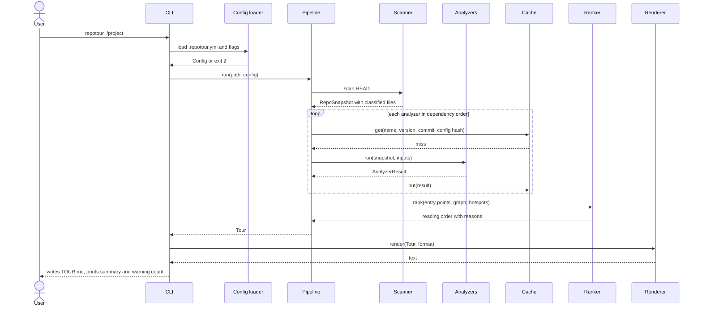
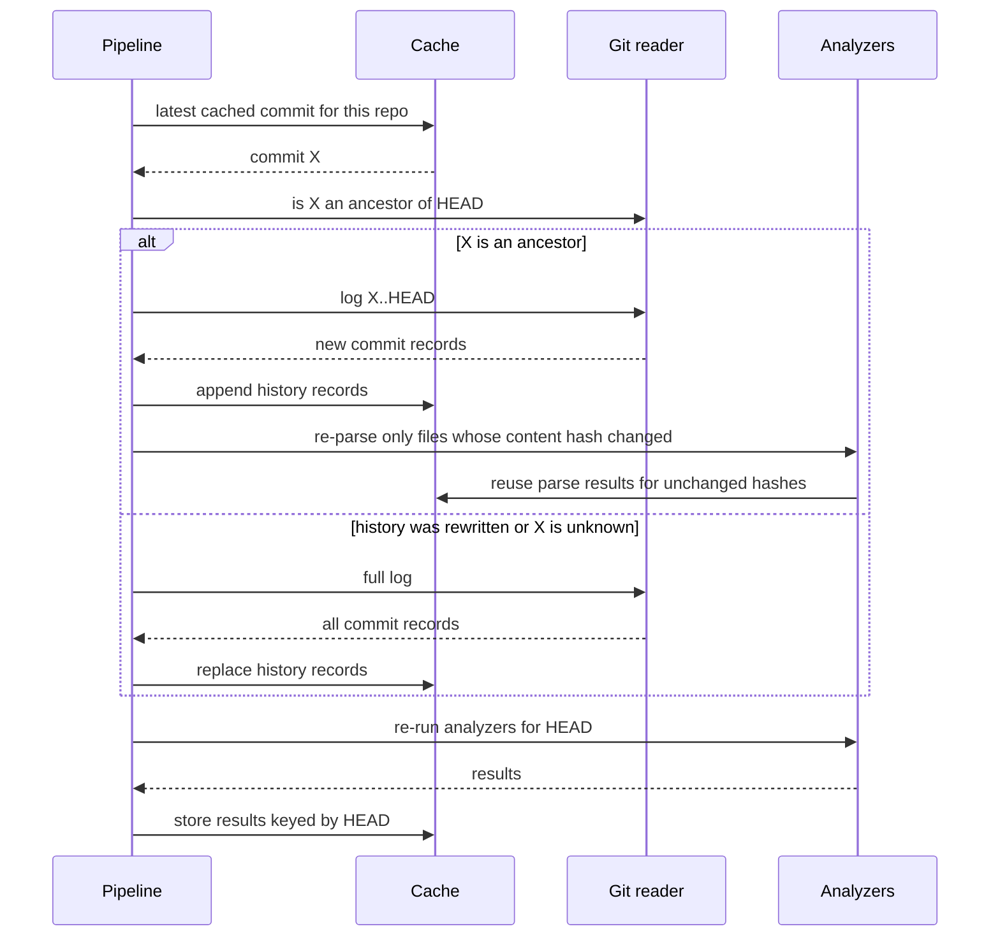
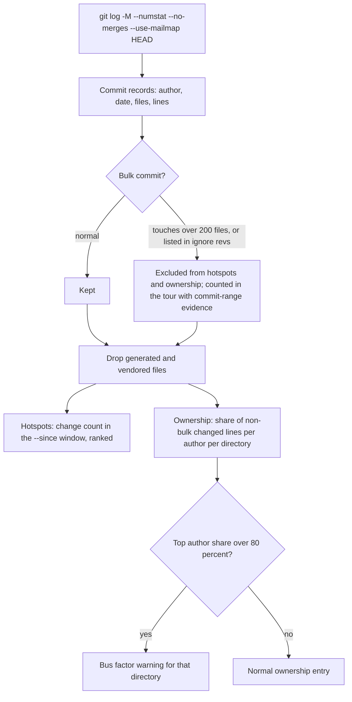
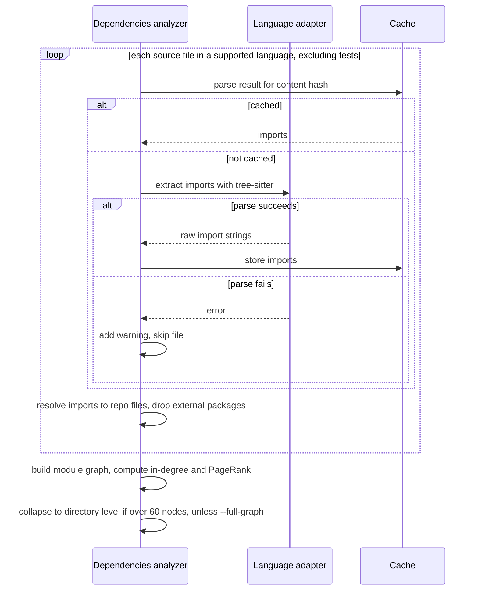
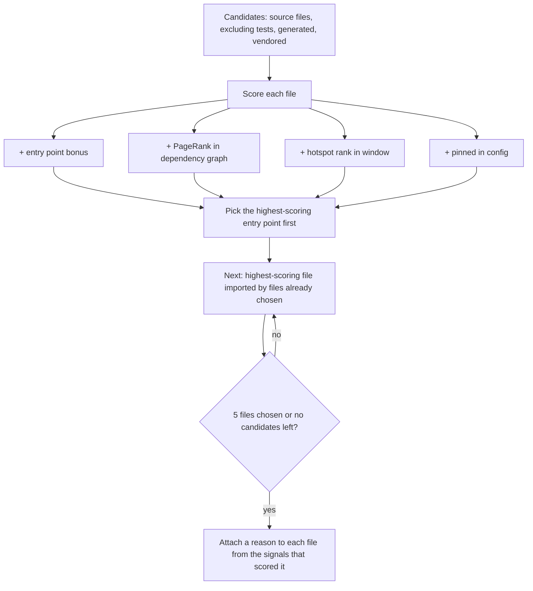
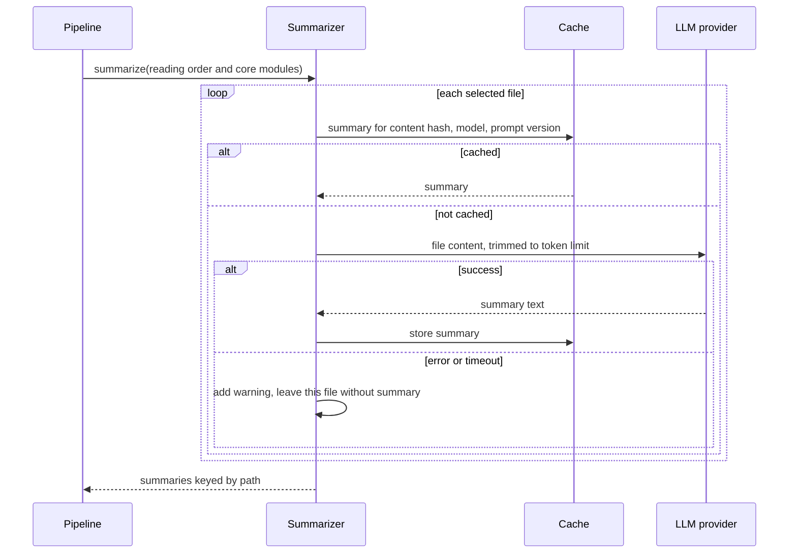
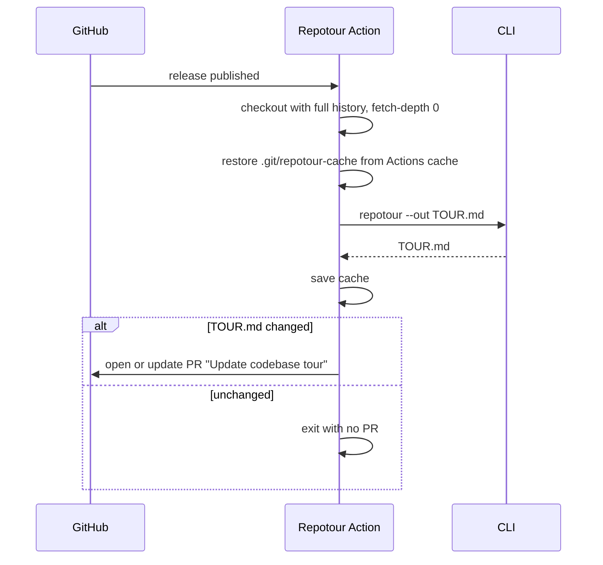

# Repotour core flows

Companion to `vision.md` and `architecture.md`. Each flow lists the steps in order, the components involved, and how failures are handled.

## Flow 1: Generate a tour (first run)

The main path: a user runs `repotour` on a repo with no cache.

Steps:

1. Verify `PATH` is inside a git repository, `git` 2.30+ is installed, and the repo has at least one commit, otherwise exit `1`. Resolve to the repo root. A shallow clone produces a "history truncated" warning, not an error.
2. Load and validate config, merge CLI flags, compute the config hash.
3. Scan tracked files at `HEAD`, hash them, classify them.
4. Run analyzers in dependency order (`history` before `ownership`), caching each result.
5. Rank the reading order.
6. If `--summaries` is set, run Flow 6.
7. Assemble the `Tour` and render it (UTF-8, LF). If the output file exists and does not start with `<!-- generated by repotour -->`, exit `4` unless `--force`. Write the file.
8. Print a short summary: output path, sections produced, warning count. Exit `0`, or `3` with `--strict` and warnings.

## Flow 2: Re-run on a newer commit (incremental)

The user pulls new commits and runs `repotour` again.

Rules:

- If `HEAD` and config hash both match a cached run, skip analysis and render from the cached results.
- Per-file parse results are keyed by content hash, so a file that moved but did not change is not re-parsed.
- `--no-cache` skips both reads and writes.

## Flow 3: History, hotspots, and ownership

Rules:

- History is commits reachable from HEAD, merges excluded, other branches ignored.
- The hotspot window is measured back from HEAD's committer date (`docs/adr/0001`).
- Authors are normalized with `.mailmap` only, so one person with several emails counts once; no name-based guessing.
- Bots (names ending in `[bot]`, plus a configurable list) are excluded from ownership and contacts.
- Ownership entries cover directories up to depth 2 with at least 5 source or test files. Each shows the top 3 authors by share, by name only, never email.
- Contacts are owners with a commit to the directory in the 12 months before HEAD.
- A bus factor warning requires a top-author share over 80 percent, at least 5 files, and at least 10 non-bulk commits.
- A directory is active with a non-bulk change inside the window, stable with no change in the 12 months before HEAD, otherwise neither.
- The tour shows the top 10 hotspots; full lists go in `--json`.
- Ignore revs come from `.git-blame-ignore-revs` plus `ignore_revs` in config.
- Renames are detected repo-wide in the single `git log -M` pass and chained by the history analyzer, so a moved file keeps its history.
- Each hotspot and ownership entry carries `commit_range` evidence; bus factor warnings also list the directory's file count.
- Thresholds (bulk commit file count, bus factor share) are configurable.

## Flow 4: Build the dependency graph

Rules:

- Import resolution is per language. Python: relative imports, top-level packages, `src/` layout. JS/TS: relative paths, index files, extension inference, `tsconfig` paths, workspace packages. Go: module path from `go.mod`, plus `go.work`.
- Only static imports count; dynamic `import()`, `require(variable)`, and `importlib` are ignored.
- Test files are excluded from the graph and PageRank.
- PageRank is our own implementation with a fixed iteration count; scores are rounded to 6 decimals.
- Collapse: if the module graph exceeds 60 nodes, collapse to directories, coarsening one level at a time until 60 or fewer; if even top-level directories exceed 60, show the top 60 by PageRank and state how many were omitted.
- If the repo has no supported language, the graph section is "unavailable: no supported language".
- Imports that resolve outside the repo are external and excluded from the graph, but counted in the overview.
- Every edge carries `import` evidence (`a.py -> b.py`).
- Core modules are the top 10 percent by PageRank; leaf modules have in-degree 0 and are not entry points.

## Flow 5: Compute the "start here" reading order

Rules:

- Scoring is fixed and not configurable in v1: entry points always outrank non-entry points; within each group, files rank by the mean of their PageRank percentile and hotspot percentile.
- Entry points are execution entry points (main, server startup, CLI, route table, scripts) or public surfaces (`__init__.py`, `package.json` `main`/`exports`, importable Go packages), labeled by kind. Without a supported language, manifest-derived entry points (`Cargo.toml`, `package.json` scripts, `Dockerfile` `CMD`) and hotspots still produce a reading order.
- Pinned entry points from config always come first.
- Fewer than 5 candidates means a shorter list, never padding.
- If no imported candidate remains, fall back to the highest-scoring unchosen file.
- Ties break by path so the order is deterministic.
- Reasons are generated from signals, never invented, for example "entry point: defines the CLI" or "imported by 14 modules, changed 32 times in 6 months".

## Flow 6: Optional LLM summaries

Runs only with `--summaries`. The provider preset (default `groq`), model, and optional `base_url` come from config. The API key is read from `REPOTOUR_LLM_API_KEY`, else the preset's own variable (`GROQ_API_KEY`, `OPENROUTER_API_KEY`); local Ollama needs none.

Rules:

- Only reading-order files and core modules are summarized, capped at 15 files per run.
- Summaries are labeled as AI-generated in the output.
- Before sending, the CLI prints to stderr the files it will send and the endpoint and model. No interactive prompt.
- An unreachable endpoint (for example, Ollama not running) is a warning; the tour still renders.
- A rate-limit response (HTTP 429) is retried after the `Retry-After` delay, within a bounded total wait; after that the remaining files are left without summaries and one warning says so.
- A missing API key with `--summaries` is a warning, not a fatal error; the tour still renders.

## Flow 7: GitHub Action on release

Rules:

- Full history is required. If the checkout is shallow, the action fails with a message explaining `fetch-depth: 0`.
- Triggers: `release: published` and `workflow_dispatch`. It is a composite action installing a pinned `repotour` from PyPI.
- The PR branch `repotour/update-tour` is reused across releases, so there is at most one open tour PR, targeting the default branch.
- Determinism (no timestamps) is what makes "unchanged" detection work.

## Flow 8: Errors and warnings

- **Fatal, stop the run:** not a git repo or git missing (exit `1`), invalid config (exit `2`).
- **Section-level:** an analyzer raises an exception, so its section renders as "unavailable" with the error message in warnings.
- **Fatal, refuse to overwrite:** output file exists without the Repotour marker and no `--force` (exit `4`).
- **File-level:** a file fails to parse, is binary (NUL byte in the first 8 KB), or exceeds 1 MB, so it is skipped and listed in warnings. Generated and vendored files are skipped silently and counted in the overview.
- **Optional features:** LLM errors or missing key become warnings, and the tour renders without summaries.
- Warnings appear in a "Warnings" section at the end of the tour and in the CLI summary. `--strict` turns any warning into exit `3`.
