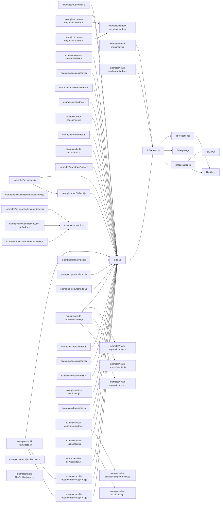

<!-- generated by repotour -->
# Codebase tour: express

Generated by Repotour 0.2.0 from commit `cf6722bf89a86905281d9160b6482e08166b5ef0` with config `79745d7776e2`.

## Overview

**Project type:** library (`package.json` index.js (Node's default main))

**How to work on it:**
- Install: `npm install --ignore-scripts --include=dev` (`.github/workflows/ci.yml` job lint); `npm install` (`.github/workflows/ci.yml` job test); `npm install -g npm@latest` (`.github/workflows/npm-publish.yml` job publish)
- Test: `npm run test-ci` (`package.json` script "test-ci": nyc --exclude examples --exclude test --exclude benchmarks --reporter=lcovonly --reporter=text npm test); `npm run test-cov` (`package.json` script "test-cov": nyc --exclude examples --exclude test --exclude benchmarks --reporter=html --reporter=text npm test); `npm run test-tap` (`package.json` script "test-tap": mocha --require test/support/env --reporter tap --check-leaks test/ test/acceptance/); `npm test` (`package.json` script "test": mocha --require test/support/env --reporter spec --check-leaks test/ test/acceptance/)
- Other: `npm run lint` (`package.json`), `npm run lint:fix` (`package.json`)

**Size:** 214 tracked files, 21584 lines of code.

| Language | Files | Lines | Largest files |
|---|---:|---:|---|
| JavaScript | 141 | 21493 | `test/app.router.js`, `lib/response.js`, `test/res.sendFile.js` |
| HTML | 8 | 46 | `examples/search/public/index.html`, `examples/ejs/views/users.html`, `examples/ejs/views/header.html` |
| CSS | 4 | 45 | `examples/route-separation/public/style.css`, `examples/mvc/public/style.css`, `examples/ejs/public/stylesheets/style.css` |

**Top-level directories:**

| Directory | Purpose | Source |
|---|---|---|
| `.github/` | GitHub workflows and repository settings | well-known directory name |
| `examples/` | This page contains list of examples using Express. | `examples/README.md` |
| `lib/` | Library code | well-known directory name |
| `test/` | Tests | well-known directory name |

**Missing basics:**
- No contributing guide (looked for CONTRIBUTING* at the root, in docs/, or in .github/)

## Start here

Read these first, in order:

1. `index.js`: entry point: package main (`package.json` "main"); imported by 27 modules
2. `lib/express.js`: imported by index.js; imported by 3 modules
3. `lib/response.js`: imported by lib/express.js; imported by 1 module; changed 7 times in the last 6 months
4. `lib/request.js`: imported by lib/express.js; imported by 1 module; changed 3 times in the last 6 months
5. `lib/application.js`: imported by lib/express.js; imported by 1 module

## Entry points

**Where execution starts:**
- `examples/auth/index.js`: starts a server (`examples/auth/index.js` line 132)
- `examples/content-negotiation/index.js`: starts a server (`examples/content-negotiation/index.js` line 44)
- `examples/cookie-sessions/index.js`: starts a server (`examples/cookie-sessions/index.js` line 23)
- `examples/cookies/index.js`: starts a server (`examples/cookies/index.js` line 51)
- `examples/downloads/index.js`: starts a server (`examples/downloads/index.js` line 38)
- `examples/ejs/index.js`: starts a server (`examples/ejs/index.js` line 55)
- `examples/error-pages/index.js`: starts a server (`examples/error-pages/index.js` line 101)
- `examples/error/index.js`: starts a server (`examples/error/index.js` line 51)
- `examples/hello-world/index.js`: starts a server (`examples/hello-world/index.js` line 13)
- `examples/markdown/index.js`: starts a server (`examples/markdown/index.js` line 42)

**Public surface** (what users of the code import):
- `index.js`: package main (`package.json` "main") (`package.json` "main": index.js)

16 more entry points not shown.

## Hotspots

Files changed most often in the 6 months before HEAD (2026-04-12 to 2026-10-09).

| File | Commits | Evidence |
|---|---:|---|
| `package.json` | 14 | `f5c159b112e8..cf6722bf89a8` (14 commits between 2026-05-17 and 2026-10-09) |
| `.github/workflows/ci.yml` | 9 | `e7fd63a38785..4e65ec983d33` (9 commits between 2026-04-23 and 2026-09-08) |
| `.github/workflows/scorecard.yml` | 9 | `6340c1eaaedc..2717ae3cbf2b` (9 commits between 2026-04-23 and 2026-10-06) |
| `.github/workflows/legacy.yml` | 8 | `e7fd63a38785..4e65ec983d33` (8 commits between 2026-04-23 and 2026-09-08) |
| `History.md` | 8 | `f873ac23124f..cf6722bf89a8` (8 commits between 2026-05-04 and 2026-10-09) |
| `.github/workflows/codeql.yml` | 7 | `6340c1eaaedc..2717ae3cbf2b` (7 commits between 2026-04-23 and 2026-10-06) |
| `lib/response.js` | 7 | `59e205a57a04..8c2fcfcb7d37` (7 commits between 2026-06-16 and 2026-10-09) |
| `lib/request.js` | 3 | `9d8223d92ee8..8c2fcfcb7d37` (3 commits between 2026-06-16 and 2026-10-09) |
| `test/res.send.js` | 3 | `cb19f04170fc..9a34acf03cb8` (3 commits between 2026-06-15 and 2026-09-15) |
| `Readme.md` | 2 | `66878d3e7043..53d4a0d606c0` (2 commits between 2026-07-05 and 2026-09-11) |

## Ownership

Who has changed each area most, by share of changed lines across history (bulk commits and bots left out). Contacts committed to the area in the 12 months before HEAD.

| Directory | Top authors | Contacts | Activity |
|---|---|---|---|
| `examples/` | TJ Holowaychuk 62% (`843281dec0ea..edd39fb194ed`), Douglas Christopher Wilson 10% (`0461e55380d2..b91c7ffb289a`), Jamie Barton 4% (`4012846d2534..3763d73a1f66`) | Viny Brun Kriesang, Sam Tucker-Davis, Chris Z | active (last change on 2026-10-06) |
| `examples/ejs/` | TJ Holowaychuk 73% (`95e6fff3daac..464608025b90`), sakateka 12% (`be7ec8b40e72..8e12dd9c1750`), Jamie Barton 6% (`57d3dfd9f828`) | Sam Tucker-Davis | - |
| `examples/mvc/` | TJ Holowaychuk 55% (`24694b004721..ab61837885f8`), Douglas Christopher Wilson 15% (`602e5a82004d..20047bb6e40e`), Jamie Barton 13% (`3763d73a1f66`) | Chris Z | active (last change on 2026-10-06) |
| `examples/route-separation/` | TJ Holowaychuk 55% (`7ded5a2de5ba..c2fa6cc94d27`), Jamie Barton 16% (`245fa8942a44`), Douglas Christopher Wilson 8% (`c18c2a8e68c6..20047bb6e40e`) | none recently | stable (last change on 2025-01-10) |
| `lib/` | TJ Holowaychuk 60% (`b4cf4f072f20..8a7a695836e6`), Douglas Christopher Wilson 21% (`2fd3e72a19aa..a10770286e74`), Jonathan Ong 4% (`e218377a3d9d..6d65ae5ba6b0`) | Blake Embrey, Sebastian Beltran, AbdelMonaam Aouini | active (last change on 2026-10-09) |
| `test/` | Douglas Christopher Wilson 47% (`2fd3e72a19aa..8c24fa8f7b6d`), TJ Holowaychuk 26% (`51a5c829bbbd..c6c71abf4d4d`), Jonathan Ong 3% (`50cb62c5d20a..328c6d306032`) | Blake Embrey, Chris de Almeida, Ulises Gascon | active (last change on 2026-10-06) |
| `test/acceptance/` | Douglas Christopher Wilson 37% (`1f938c560a39..a84e73b958a6`), TJ Holowaychuk 33% (`29ef828b9cda..d653d2308b0f`), Robert Sköld 23% (`ac387caf2157..4dbaaa285559`) | Blake Embrey | active (last change on 2026-06-16) |
| `test/fixtures/` | Douglas Christopher Wilson 87% (`2fd3e72a19aa..6f7a8301a182`), Tj Holowaychuk 13% (`66f8ca52d6fc..19e3384bb17a`) | none recently | stable (last change on 2019-05-02) |

## Dependency graph

How modules import each other (JavaScript/TypeScript; static imports only; tests, generated, and vendored files left out). 50 modules, 49 imports inside the repository.

**Core modules** (most depended on, by PageRank): `index.js` (imported by 27 modules; PageRank 1 of 50), `lib/express.js` (imported by 3 modules; PageRank 2 of 50), `lib/utils.js` (imported by 2 modules; PageRank 3 of 50), `lib/application.js` (imported by 1 module; PageRank 4 of 50), `lib/request.js` (imported by 1 module; PageRank 5 of 50).

48 external modules imported, e.g. `accepts`, `body-parser`, `connect-redis`, `content-disposition`, `content-type`.
