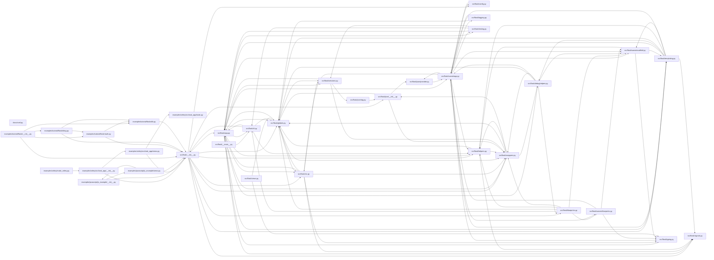

<!-- generated by repotour -->
# Codebase tour: flask

Generated by Repotour 0.2.0 from commit `22d924701a6ae2e4cd01e9a15bbaf3946094af65` with config `79745d7776e2`.

## Overview

**Project type:** library (`pyproject.toml` [project]), CLI (`pyproject.toml` [project.scripts])

**How to work on it:**
- Test: `uv run --locked tox run -e typing` (`.github/workflows/tests.yaml` job typing)

**Size:** 234 tracked files, 18421 lines of code.

| Language | Files | Lines | Largest files |
|---|---:|---:|---|
| Python | 83 | 17889 | `tests/test_basic.py`, `src/flask/app.py`, `src/flask/cli.py` |
| HTML | 20 | 362 | `examples/celery/src/task_app/templates/index.html`, `examples/javascript/js_example/templates/base.html`, `examples/javascript/js_example/templates/fetch.html` |
| CSS | 2 | 135 | `examples/tutorial/flaskr/static/style.css`, `tests/test_apps/blueprintapp/apps/admin/static/css/test.css` |
| SQL | 2 | 28 | `examples/tutorial/flaskr/schema.sql`, `examples/tutorial/tests/data.sql` |
| Shell | 1 | 7 | `.devcontainer/on-create-command.sh` |

**Top-level directories:**

| Directory | Purpose | Source |
|---|---|---|
| `.devcontainer/` | Development container configuration | well-known directory name |
| `.github/` | GitHub workflows and repository settings | well-known directory name |
| `docs/` | Documentation | well-known directory name |
| `examples/` | Examples | well-known directory name |
| `src/` | Source code | well-known directory name |
| `tests/` | Tests | well-known directory name |

**Not counted:**
- 1 generated file, e.g. `uv.lock` (lockfile)

## Start here

Read these first, in order:

1. `src/flask/cli.py`: entry point: defines a CLI (Click); runs as a script; console script `flask`; imported by 4 modules
2. `src/flask/app.py`: imported by src/flask/cli.py; imported by 7 modules; changed 2 times in the last 6 months
3. `src/flask/sansio/app.py`: imported by src/flask/app.py; imported by 7 modules
4. `src/flask/sessions.py`: imported by src/flask/app.py; imported by 4 modules; changed 3 times in the last 6 months
5. `src/flask/ctx.py`: imported by src/flask/app.py; imported by 4 modules

## Entry points

**Where execution starts:**
- `src/flask/__main__.py`: runs with `python -m flask` (`src/flask/__main__.py` package __main__ module)
- `src/flask/cli.py`: defines a CLI (Click); runs as a script; console script `flask` (`src/flask/cli.py` line 890; `src/flask/cli.py` line 1134; `pyproject.toml` [project.scripts] flask = flask.cli:main)
- `examples/celery/src/task_app/__init__.py`: defines a web app (Flask) (`examples/celery/src/task_app/__init__.py` line 8)
- `examples/javascript/js_example/__init__.py`: defines a web app (Flask) (`examples/javascript/js_example/__init__.py` line 3)
- `examples/tutorial/flaskr/__init__.py`: defines a web app (Flask) (`examples/tutorial/flaskr/__init__.py` line 8)
- `examples/tutorial/flaskr/db.py`: defines a CLI (Click) (`examples/tutorial/flaskr/db.py` line 41)

**Public surface** (what users of the code import):
- `src/flask/__init__.py`: top-level package `flask` (`src/flask/__init__.py` package root)
- `examples/celery/src/task_app/__init__.py`: top-level package `task_app` (`examples/celery/src/task_app/__init__.py` package root)
- `examples/javascript/js_example/__init__.py`: top-level package `js_example` (`examples/javascript/js_example/__init__.py` package root)
- `examples/tutorial/flaskr/__init__.py`: top-level package `flaskr` (`examples/tutorial/flaskr/__init__.py` package root)

## Hotspots

Files changed most often in the 6 months before HEAD (2025-08-23 to 2026-02-19).

| File | Commits | Evidence |
|---|---:|---|
| `pyproject.toml` | 7 | `917000097fc1..22d924701a6a` (7 commits between 2025-11-17 and 2026-02-19) |
| `.github/workflows/tests.yaml` | 6 | `da6d075dfde7..64dd0809c2fc` (6 commits between 2025-11-17 and 2026-01-25) |
| `.pre-commit-config.yaml` | 5 | `da6d075dfde7..3709c4a9a87e` (5 commits between 2025-11-17 and 2026-01-25) |
| `.github/workflows/pre-commit.yaml` | 3 | `da6d075dfde7..64dd0809c2fc` (3 commits between 2025-11-17 and 2026-01-25) |
| `.github/workflows/publish.yaml` | 3 | `da6d075dfde7..64dd0809c2fc` (3 commits between 2025-11-17 and 2026-01-25) |
| `CHANGES.rst` | 3 | `27be93384053..22d924701a6a` (3 commits between 2026-02-18 and 2026-02-19) |
| `src/flask/sessions.py` | 3 | `da6d075dfde7..c17f37939073` (3 commits between 2025-11-17 and 2026-02-19) |
| `src/flask/app.py` | 2 | `3709c4a9a87e..c17f37939073` (2 commits between 2026-01-25 and 2026-02-19) |
| `.github/workflows/lock.yaml` | 1 | `97bddc1f61a5` (1 commit on 2026-01-05) |
| `docs/async-await.rst` | 1 | `ac5664d22815` (1 commit on 2026-01-25) |

## Ownership

Who has changed each area most, by share of changed lines across history (bulk commits and bots left out). Contacts committed to the area in the 12 months before HEAD.

| Directory | Top authors | Contacts | Activity |
|---|---|---|---|
| `examples/` | David Lord 80% (`c3dd7b8e4c9e..a9b99b3489cc`), David Baumgold 15% (`025589ee7662`), Grey Li 3% (`21b0aa6dd8b4..bd26928fdb24`) | Markus Heidelberg | active (last change on 2026-01-27) |
| `examples/celery/` | David Lord 100% (`3f195248dcd5..a9b99b3489cc`) | none recently | stable (last change on 2024-11-02) |
| `examples/javascript/` | David Lord 85% (`fce1885f7614..a9b99b3489cc`), David Baumgold 9% (`025589ee7662`), Grey Li 4% (`21b0aa6dd8b4..ef434ea9985b`) | none recently | stable (last change on 2024-11-02) |
| `examples/tutorial/` | David Lord 74% (`c3dd7b8e4c9e..a9b99b3489cc`), David Baumgold 21% (`025589ee7662`), Grey Li 3% (`21b0aa6dd8b4..bd26928fdb24`) | Markus Heidelberg | active (last change on 2026-01-27) |
| `src/` | David Lord 41% (`992d9be96ef0..c17f37939073`), Armin Ronacher 20% (`8798b4b7112f..4a1acc8b5f0b`), pgjones 13% (`7bf8366970ec..d718ecf6d3df`) | David Lord, George Waters, CoolCat467 | active (last change on 2026-02-19) |
| `src/flask/` | David Lord 41% (`992d9be96ef0..c17f37939073`), Armin Ronacher 20% (`8798b4b7112f..4a1acc8b5f0b`), pgjones 13% (`7bf8366970ec..d718ecf6d3df`) | David Lord, George Waters, CoolCat467 | active (last change on 2026-02-19) |
| `tests/` | Markus Unterwaditzer 33% (`961db8ad7290..c935eaceafeb`), David Lord 24% (`024fbe5a6076..c17f37939073`), David Baumgold 16% (`025589ee7662`) | David Lord, James Addison | active (last change on 2026-02-19) |
| `tests/templates/` | Armin Ronacher 56% (`08f1f0dc3200..f034d8d3451f`), Alan Hamlett 32% (`99c99c4c16b1`), Jon S. Stumpf 8% (`549fed29ea0b`) | none recently | stable (last change on 2019-06-01) |
| `tests/test_apps/` | David Lord 32% (`fb845b903282..54e05a282428`), Armin Ronacher 25% (`2a73bbc43604..bafc13981002`), David Baumgold 23% (`025589ee7662`) | none recently | stable (last change on 2023-11-15) |

**Bus-factor warnings** (one person holds most of a big, busy area):
- `examples/javascript/`: David Lord made 85% of the changes (`fce1885f7614..a9b99b3489cc`; 16 commits, 411 lines changed; directory has 8 files and 23 commits)

## Dependency graph

How modules import each other (Python; static imports only; tests, generated, and vendored files left out). 35 modules, 114 imports inside the repository.

**Core modules** (most depended on, by PageRank): `src/flask/globals.py` (imported by 12 modules; PageRank 1 of 35), `src/flask/wrappers.py` (imported by 9 modules; PageRank 2 of 35), `src/flask/sansio/app.py` (imported by 7 modules; PageRank 3 of 35), `src/flask/app.py` (imported by 7 modules; PageRank 4 of 35).

**Leaf modules** (nothing imports them; safe places for a first change): `src/flask/views.py`.

52 external modules imported, e.g. `_typeshed`, `asgiref`, `ast`, `base64`, `blinker`.
