<!-- generated by repotour -->
# Codebase tour: fzf

Generated by Repotour 0.2.0 from commit `c7bf2b8eea25952dd257a466c0afa72faae206fb` with config `79745d7776e2`.

## Overview

**Project type:** library (`src/algo/algo.go` importable Go package; `src/ansi.go` importable Go package; `src/protector/protector.go` importable Go package), CLI (`main.go` package main)

**How to work on it:**
- Install: `make install` (`Makefile` target install)
- Test: `make test` (`Makefile` target test: SHELL=/bin/sh GOOS= $(GO) test -v -tags "$(TAGS)" …)
- Other: `make all` (`Makefile`), `make bench` (`Makefile`), `make build` (`Makefile`), `make clean` (`Makefile`), `make docker` (`Makefile`), `make docker-test` (`Makefile`), `make fmt` (`Makefile`), `make fuzz` (`Makefile`)

**Size:** 160 tracked files, 44705 lines of code.

| Language | Files | Lines | Largest files |
|---|---:|---:|---|
| Go | 89 | 34004 | `src/terminal.go`, `src/options.go`, `src/tui/light.go` |
| Ruby | 11 | 8768 | `test/test_core.rb`, `test/test_layout.rb`, `test/test_shell_integration.rb` |
| Shell | 8 | 1868 | `shell/completion.bash`, `shell/completion.zsh`, `shell/key-bindings.zsh` |
| PowerShell | 1 | 65 | `install.ps1` |

**Top-level directories:**

| Directory | Purpose | Source |
|---|---|---|
| `.github/` | GitHub workflows and repository settings | well-known directory name |
| `bin/` | Executables and launcher scripts | well-known directory name |
| `doc/` | Documentation | well-known directory name |
| `man/` | 2 files: 2 other | file categories |
| `plugin/` | 1 file: 1 other | file categories |
| `shell/` | 11 files: 6 source (Shell), 5 other | file categories |
| `src/` | Source code | well-known directory name |
| `test/` | Tests | well-known directory name |
| `wix/` | 1 file: 1 other | file categories |

**Missing basics:**
- No contributing guide (looked for CONTRIBUTING* at the root, in docs/, or in .github/)

**Not counted:**
- 4 generated files, e.g. `Gemfile.lock` (lockfile), `go.sum` (lockfile), `src/actiontype_string.go` (generated-file header (DO NOT EDIT))

## Start here

Read these first, in order:

1. `main.go`: entry point: Go program (package main); changed 4 times in the last 6 months
2. `src/terminal.go`: imported by main.go; imported by 1 module; changed 33 times in the last 6 months
3. `src/tui/tui.go`: imported by src/terminal.go; imported by 7 modules; changed 4 times in the last 6 months
4. `src/util/util.go`: imported by src/terminal.go; imported by 19 modules
5. `src/protector/protector.go`: imported by main.go; imported by 1 module

## Entry points

**Where execution starts:**
- `main.go`: Go program (package main) (`main.go` line 1)

## Hotspots

Files changed most often in the 6 months before HEAD (2026-05-11 to 2026-11-07).

| File | Commits | Evidence |
|---|---:|---|
| `CHANGELOG.md` | 60 | `fcc3c6acce5c..69114661a69c` (60 commits between 2026-05-17 and 2026-11-07) |
| `src/terminal.go` | 33 | `fcc3c6acce5c..69114661a69c` (33 commits between 2026-05-17 and 2026-11-07) |
| `man/man1/fzf.1` | 30 | `fcc3c6acce5c..c7bf2b8eea25` (30 commits between 2026-05-17 and 2026-11-07) |
| `test/test_core.rb` | 16 | `fcc3c6acce5c..99bfd5aa0f66` (16 commits between 2026-05-17 and 2026-11-02) |
| `install` | 15 | `290b18d9fe1f..c7bf2b8eea25` (15 commits between 2026-05-23 and 2026-11-07) |
| `src/tui/light.go` | 15 | `9e4f8e7b7ada..33a3456921a1` (15 commits between 2026-06-28 and 2026-10-08) |
| `src/options.go` | 12 | `fcc3c6acce5c..99bfd5aa0f66` (12 commits between 2026-05-17 and 2026-11-02) |
| `RELEASE.md` | 11 | `5e137613d3bc..c7bf2b8eea25` (11 commits between 2026-05-23 and 2026-11-07) |
| `install.ps1` | 9 | `a24deef77bc1..c7bf2b8eea25` (9 commits between 2026-05-23 and 2026-11-07) |
| `man/man1/fzf-tmux.1` | 9 | `a24deef77bc1..c7bf2b8eea25` (9 commits between 2026-05-23 and 2026-11-07) |

## Ownership

Who has changed each area most, by share of changed lines across history (bulk commits and bots left out). Contacts committed to the area in the 12 months before HEAD.

| Directory | Top authors | Contacts | Activity |
|---|---|---|---|
| `shell/` | Junegunn Choi 45% (`fa5617e0764e..cbc11e4d9591`), bitraid 14% (`ed76f076ddb8..a1e983baf1a5`), Simon Désaulniers 9% (`290b18d9fe1f..55c122f1a0e1`) | Junegunn Choi, bitraid, Simon Désaulniers | active (last change on 2026-10-17) |
| `src/` | Junegunn Choi 91% (`f3177305d557..69114661a69c`), Vlastimil Ovčáčík 2% (`88d74a15aaeb..a33c011c2160`), Massimo Mund 1% (`9ed971cc90c9..c3e6d9a8f983`) | Junegunn Choi, Massimo Mund, Marcel Meyer | active (last change on 2026-11-07) |
| `src/algo/` | Junegunn Choi 97% (`f3177305d557..2885df8395d3`), Khon Trieu 1% (`4ec144c969ef`), Keating950 1% (`3f90fb42d887`) | Junegunn Choi, Marcel Meyer, phanium | active (last change on 2026-08-10) |
| `src/tui/` | Junegunn Choi 80% (`e70a2a581758..33a3456921a1`), Massimo Mund 7% (`9ed971cc90c9..c3e6d9a8f983`), Vlastimil Ovčáčík 4% (`f4f47f5fe32d..00fb486f6a5f`) | Junegunn Choi, Massimo Mund, Jason Han | active (last change on 2026-10-08) |
| `src/util/` | Junegunn Choi 78% (`f3177305d557..961793cf39a1`), Daehyun Kim 6% (`c8c2d0828a94`), Marcel Meyer 5% (`6eb4b41e343a..14b5e1d88ce8`) | Junegunn Choi, Daehyun Kim, Marcel Meyer | active (last change on 2026-10-15) |
| `test/` | Junegunn Choi 89% (`e7439ce193f4..69114661a69c`), LM 6% (`7e62b34087a7`), Simon Désaulniers 2% (`290b18d9fe1f`) | Junegunn Choi, LM, Simon Désaulniers | active (last change on 2026-11-07) |

**Bus-factor warnings** (one person holds most of a big, busy area):
- `src/`: Junegunn Choi made 91% of the changes (`f3177305d557..69114661a69c`; 1357 commits, 71235 lines changed; directory has 88 files and 1502 commits)
- `src/algo/`: Junegunn Choi made 97% of the changes (`f3177305d557..2885df8395d3`; 65 commits, 6001 lines changed; directory has 12 files and 76 commits)
- `test/`: Junegunn Choi made 89% of the changes (`e7439ce193f4..69114661a69c`; 154 commits, 9263 lines changed; directory has 14 files and 175 commits)

## Dependency graph

How modules import each other (Go; static imports only; tests, generated, and vendored files left out). 58 modules, 31 imports inside the repository.

```mermaid
flowchart LR
    n0["main.go"]
    n1["src/algo/algo.go"]
    n2["src/algo/indexbyte2_amd64.go"]
    n3["src/algo/indexbyte2_arm64.go"]
    n4["src/algo/indexbyte2_other.go"]
    n5["src/algo/normalize.go"]
    n6["src/algo/runeindex_others.go"]
    n7["src/algo/runeindex_ref.go"]
    n8["src/algo/runeindex_x86.go"]
    n9["src/ansi.go"]
    n10["src/cache.go"]
    n11["src/chunklist.go"]
    n12["src/constants.go"]
    n13["src/core.go"]
    n14["src/functions.go"]
    n15["src/history.go"]
    n16["src/item.go"]
    n17["src/matcher.go"]
    n18["src/merger.go"]
    n19["src/options.go"]
    n20["src/options_no_pprof.go"]
    n21["src/options_pprof.go"]
    n22["src/pattern.go"]
    n23["src/protector/protector.go"]
    n24["src/protector/protector_openbsd.go"]
    n25["src/proxy.go"]
    n26["src/proxy_unix.go"]
    n27["src/proxy_windows.go"]
    n28["src/reader.go"]
    n29["src/result.go"]
    n30["src/result_others.go"]
    n31["src/result_x86.go"]
    n32["src/server.go"]
    n33["src/terminal.go"]
    n34["src/terminal_unix.go"]
    n35["src/terminal_windows.go"]
    n36["src/tmux.go"]
    n37["src/tokenizer.go"]
    n38["src/tui/dummy.go"]
    n39["src/tui/light.go"]
    n40["src/tui/light_unix.go"]
    n41["src/tui/light_windows.go"]
    n42["src/tui/tcell.go"]
    n43["src/tui/ttyname_unix.go"]
    n44["src/tui/ttyname_windows.go"]
    n45["src/tui/tui.go"]
    n46["src/util/atexit.go"]
    n47["src/util/atomicbool.go"]
    n48["src/util/chars.go"]
    n49["src/util/concurrent_set.go"]
    n50["src/util/eventbox.go"]
    n51["src/util/slab.go"]
    n52["src/util/util.go"]
    n53["src/util/util_unix.go"]
    n54["src/util/util_windows.go"]
    n55["src/winpty.go"]
    n56["src/winpty_windows.go"]
    n57["src/zellij.go"]
    n0 --> n23
    n0 --> n33
    n1 --> n52
    n9 --> n1
    n9 --> n45
    n12 --> n52
    n13 --> n45
    n13 --> n52
    n16 --> n52
    n17 --> n52
    n19 --> n1
    n19 --> n45
    n19 --> n52
    n21 --> n52
    n22 --> n1
    n22 --> n52
    n25 --> n45
    n25 --> n52
    n28 --> n52
    n29 --> n45
    n29 --> n52
    n33 --> n45
    n33 --> n52
    n36 --> n45
    n37 --> n52
    n39 --> n52
    n40 --> n52
    n41 --> n52
    n42 --> n52
    n45 --> n52
    n56 --> n52
```

**Core modules** (most depended on, by PageRank): `src/util/util.go` (imported by 19 modules; PageRank 1 of 58), `src/tui/tui.go` (imported by 7 modules; PageRank 2 of 58), `src/algo/algo.go` (imported by 3 modules; PageRank 3 of 58), `src/protector/protector.go` (imported by 1 module; PageRank 4 of 58), `src/terminal.go` (imported by 1 module; PageRank 5 of 58).

40 external modules imported, e.g. `bufio`, `bytes`, `cmp`, `context`, `crypto/subtle`.
