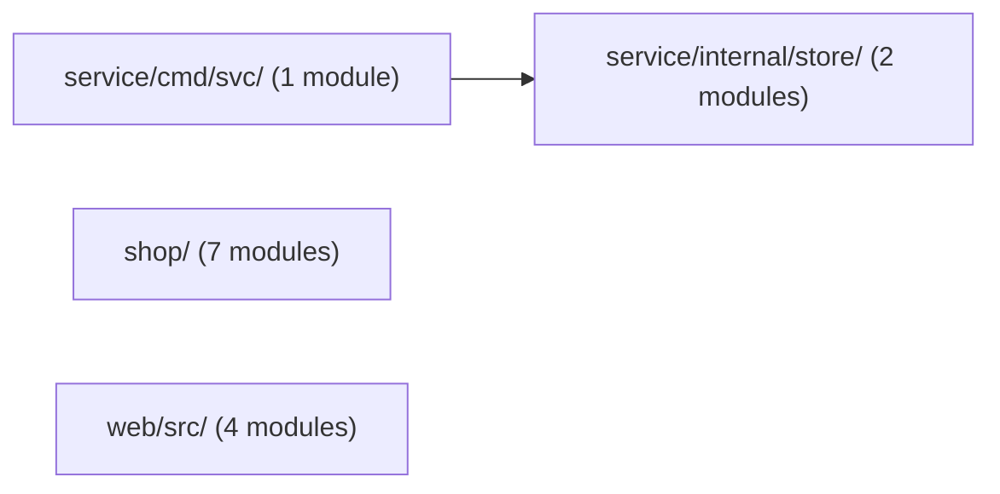

<!-- generated by repotour -->
# Codebase tour: graph-showcase

Generated by Repotour 0.2.0 from commit `fefaf6098dec898264ad4dfd02358d7d9f4be01b` with config `31c4cd853816`.

## Overview

**Project type:** monorepo (`service/go.mod` manifests in 2 directories; `web/package.json` manifests in 2 directories), library (`pyproject.toml` [project]; `web/package.json` "main"), CLI (`pyproject.toml` [project.scripts]; `service/cmd/svc/main.go` package main)

**Packages:**
- `service` (example.com/service), from `service/go.mod`
- `web` (web), from `web/package.json`

**How to work on it:** no install, run, or test commands found (looked in Makefile, justfile, package.json scripts, pyproject.toml task runners, tox.ini, noxfile.py, and GitHub Actions workflows).

**Size:** 19 tracked files, 31 lines of code.

| Language | Files | Lines | Largest files |
|---|---:|---:|---|
| Python | 7 | 13 | `shop/cli.py`, `shop/orders.py`, `shop/__init__.py` |
| Go | 3 | 11 | `service/cmd/svc/main.go`, `service/internal/store/cache.go`, `service/internal/store/store.go` |
| TypeScript | 4 | 7 | `web/src/routes.ts`, `web/src/server.ts`, `web/src/views.tsx` |

**Top-level directories:**

| Directory | Purpose | Source |
|---|---|---|
| `service/` | 4 files: 3 source (Go), 1 other | file categories |
| `shop/` | 7 files: 7 source (Python) | file categories |
| `web/` | Web frontend | well-known directory name |

**Missing basics:**
- No README (looked for a README at the repository root)
- No tests (looked for any file classified as a test)
- No contributing guide (looked for CONTRIBUTING* at the root, in docs/, or in .github/)
- No license (looked for LICENSE*, LICENCE*, or COPYING* at the repository root)
- No CI configuration (looked for GitHub Actions, GitLab CI, CircleCI, Jenkins, Azure, Travis, Bitbucket, Buildkite, Drone, or AppVeyor configuration)

## Start here

Read these first, in order:

1. `service/cmd/svc/main.go`: entry point: Go program (package main)
2. `service/internal/store/store.go`: imported by service/cmd/svc/main.go; imported by 1 module
3. `shop/cli.py`: entry point: defines a CLI (Typer); console script `shop`
4. `shop/orders.py`: imported by shop/cli.py; imported by 1 module; changed 4 times in the last 6 months
5. `shop/db.py`: imported by shop/orders.py; imported by 3 modules

## Entry points

**Where execution starts:**
- `service/cmd/svc/main.go`: Go program (package main) (`service/cmd/svc/main.go` line 1)
- `shop/cli.py`: defines a CLI (Typer); console script `shop` (`shop/cli.py` line 5; `pyproject.toml` [project.scripts] shop = shop.cli:main)
- `web/src/server.ts`: starts a server (`web/src/server.ts` line 2)

**Public surface** (what users of the code import):
- `shop/__init__.py`: top-level package `shop` (`shop/__init__.py` package root)
- `web/src/server.ts`: package main (`web/package.json` "main") (`web/package.json` "main": src/server.ts)

## Hotspots

Files changed most often in the 6 months before HEAD (2023-10-04 to 2024-04-01).

| File | Commits | Evidence |
|---|---:|---|
| `shop/orders.py` | 4 | `5b46e9ade95a..fefaf6098dec` (4 commits between 2024-01-01 and 2024-04-01) |
| `.repotour.yml` | 1 | `5b46e9ade95a` (1 commit on 2024-01-01) |
| `pyproject.toml` | 1 | `5b46e9ade95a` (1 commit on 2024-01-01) |
| `service/cmd/svc/main.go` | 1 | `5b46e9ade95a` (1 commit on 2024-01-01) |
| `service/go.mod` | 1 | `5b46e9ade95a` (1 commit on 2024-01-01) |
| `service/internal/store/cache.go` | 1 | `5b46e9ade95a` (1 commit on 2024-01-01) |
| `service/internal/store/store.go` | 1 | `5b46e9ade95a` (1 commit on 2024-01-01) |
| `shop/__init__.py` | 1 | `5b46e9ade95a` (1 commit on 2024-01-01) |
| `shop/cli.py` | 1 | `5b46e9ade95a` (1 commit on 2024-01-01) |
| `shop/db.py` | 1 | `5b46e9ade95a` (1 commit on 2024-01-01) |

## Ownership

Who has changed each area most, by share of changed lines across history (bulk commits and bots left out). Contacts committed to the area in the 12 months before HEAD.

| Directory | Top authors | Contacts | Activity |
|---|---|---|---|
| `shop/` | Ada Lovelace 100% (`5b46e9ade95a..fefaf6098dec`) | Ada Lovelace | active (last change on 2024-04-01) |

## Dependency graph

How modules import each other (Go, JavaScript/TypeScript, Python; static imports only; tests, generated, and vendored files left out). 14 modules, 10 imports inside the repository.
Collapsed to directories 3 levels deep to stay readable (run with `--full-graph` to draw every module).

**Core modules** (most depended on, by PageRank): `shop/db.py` (imported by 3 modules; PageRank 1 of 14), `web/src/theme.ts` (imported by 1 module; PageRank 2 of 14).

**Leaf modules** (nothing imports them; safe places for a first change): `shop/legacy.py`.

2 external modules imported, e.g. `sqlite3`, `typer`.
