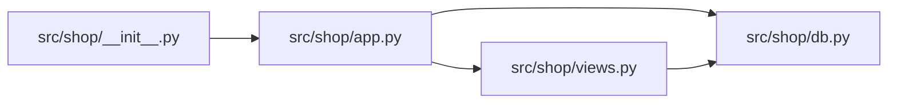

<!-- generated by repotour -->
# Codebase tour: graph

Generated by Repotour 0.3.0 from commit `45ab72dc4f955bf69f366cc57bdffd4cfa593c6f` with config `0f8aa4eebf78`.

## Overview

**Project type:** unknown (no recognized manifest or build file)

**How to work on it:** no install, run, or test commands found (looked in Makefile, justfile, package.json scripts, pyproject.toml task runners, tox.ini, noxfile.py, and GitHub Actions workflows).

**Size:** 5 tracked files, 6 lines of code.

| Language | Files | Lines | Largest files |
|---|---:|---:|---|
| Python | 5 | 6 | `src/shop/app.py`, `src/shop/__init__.py`, `src/shop/db.py` |

**Top-level directories:**

| Directory | Purpose | Source |
|---|---|---|
| `src/` | Source code | well-known directory name |
| `tests/` | Tests | well-known directory name |

**Missing basics:**
- No README (looked for a README at the repository root)
- No contributing guide (looked for CONTRIBUTING* at the root, in docs/, or in .github/)
- No license (looked for LICENSE*, LICENCE*, or COPYING* at the repository root)
- No CI configuration (looked for GitHub Actions, GitLab CI, CircleCI, Jenkins, Azure, Travis, Bitbucket, Buildkite, Drone, or AppVeyor configuration)

## Start here

Read these first, in order:

1. `src/shop/__init__.py`: entry point: top-level package `shop`
2. `src/shop/app.py`: imported by src/shop/__init__.py; imported by 1 module
3. `src/shop/db.py`: imported by src/shop/app.py; imported by 2 modules
4. `src/shop/views.py`: imported by src/shop/app.py; imported by 1 module

## Entry points

**Public surface** (what users of the code import):
- `src/shop/__init__.py`: top-level package `shop` (`src/shop/__init__.py` package root)

## Hotspots

Files changed most often in the 6 months before HEAD (2023-07-05 to 2024-01-01).

| File | Commits | Evidence |
|---|---:|---|
| `src/shop/__init__.py` | 1 | `45ab72dc4f95` (1 commit on 2024-01-01) |
| `src/shop/app.py` | 1 | `45ab72dc4f95` (1 commit on 2024-01-01) |
| `src/shop/db.py` | 1 | `45ab72dc4f95` (1 commit on 2024-01-01) |
| `src/shop/views.py` | 1 | `45ab72dc4f95` (1 commit on 2024-01-01) |
| `tests/test_app.py` | 1 | `45ab72dc4f95` (1 commit on 2024-01-01) |

## Ownership

No directory has enough source or test files for an ownership entry.

## Dependency graph

How modules import each other (Python; static imports only; tests, generated, and vendored files left out). 4 modules, 4 imports inside the repository.

**Core modules** (most depended on, by PageRank): `src/shop/db.py` (imported by 2 modules; PageRank 1 of 4).

2 external modules imported, e.g. `os`, `sqlite3`.
