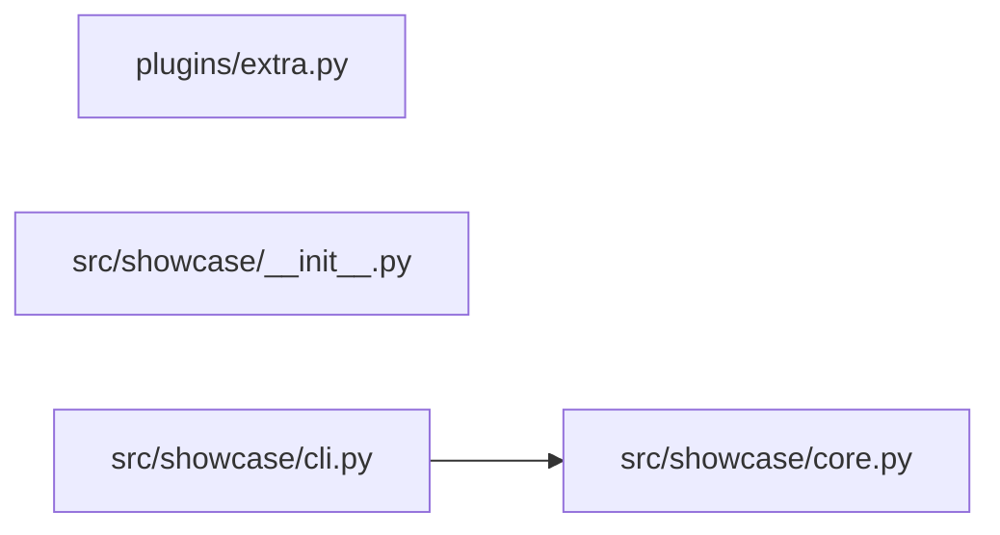

<!-- generated by repotour -->
# Codebase tour: Showcase

Generated by Repotour 0.3.0 from commit `09cdd2f2254503a6a237f4169518b33c4659b80e` with config `e43e8f3b4dfd`.

## Overview

**Project type:** library (`pyproject.toml` [project]), CLI (`pyproject.toml` [project.scripts])

**How to work on it:**
- Install: `make install` (`Makefile` target install: pip install -e .)
- Test: `make test` (`Makefile` target test: pytest)

**Size:** 14 tracked files, 11 lines of code.

| Language | Files | Lines | Largest files |
|---|---:|---:|---|
| Python | 5 | 10 | `src/showcase/cli.py`, `src/showcase/core.py`, `tests/test_core.py` |
| Shell | 1 | 1 | `tools/bump.sh` |

**Top-level directories:**

| Directory | Purpose | Source |
|---|---|---|
| `.github/` | GitHub workflows and repository settings | well-known directory name |
| `assets/` | Static assets | well-known directory name |
| `external/` | 1 submodule | file categories |
| `plugins/` | Optional extensions for the CLI. | `plugins/README.md` |
| `src/` | Source code | well-known directory name |
| `tests/` | Tests | well-known directory name |
| `tools/` | Maintainer scripts; safe to ignore at first. | note in `.repotour.yml` |
| `vendor/` | Vendored third-party code | well-known directory name |

**Maintainer notes** (from `.repotour.yml`):
- `src/showcase/core.py`: Start reading here.

**Missing basics:**
- No contributing guide (looked for CONTRIBUTING* at the root, in docs/, or in .github/)
- No license (looked for LICENSE*, LICENCE*, or COPYING* at the repository root)

**Not counted:**
- 2 generated files, e.g. `src/showcase/_version.py` (linguist-generated in .gitattributes), `uv.lock` (lockfile)
- 1 vendored file, e.g. `vendor/legacy.py` (vendored path vendor/)

**Submodules (not entered):** `external/theme`

## Start here

Read these first, in order:

1. `src/showcase/cli.py`: entry point: console script `showcase`
2. `src/showcase/core.py`: imported by src/showcase/cli.py; imported by 1 module

## Entry points

**Where execution starts:**
- `src/showcase/cli.py`: console script `showcase` (`pyproject.toml` [project.scripts] showcase = showcase.cli:main)

**Public surface** (what users of the code import):
- `src/showcase/__init__.py`: top-level package `showcase` (`src/showcase/__init__.py` package root)

## Hotspots

Files changed most often in the 6 months before HEAD (2023-07-05 to 2024-01-01).

| File | Commits | Evidence |
|---|---:|---|
| `.gitattributes` | 1 | `09cdd2f22545` (1 commit on 2024-01-01) |
| `.github/workflows/ci.yml` | 1 | `09cdd2f22545` (1 commit on 2024-01-01) |
| `.repotour.yml` | 1 | `09cdd2f22545` (1 commit on 2024-01-01) |
| `Makefile` | 1 | `09cdd2f22545` (1 commit on 2024-01-01) |
| `README.md` | 1 | `09cdd2f22545` (1 commit on 2024-01-01) |
| `assets/logo.png` | 1 | `09cdd2f22545` (1 commit on 2024-01-01) |
| `plugins/README.md` | 1 | `09cdd2f22545` (1 commit on 2024-01-01) |
| `plugins/extra.py` | 1 | `09cdd2f22545` (1 commit on 2024-01-01) |
| `pyproject.toml` | 1 | `09cdd2f22545` (1 commit on 2024-01-01) |
| `src/showcase/__init__.py` | 1 | `09cdd2f22545` (1 commit on 2024-01-01) |

## Ownership

No directory has enough source or test files for an ownership entry.

## Dependency graph

How modules import each other (Python; static imports only; tests, generated, and vendored files left out). 4 modules, 1 import inside the repository.

**Core modules** (most depended on, by PageRank): `src/showcase/core.py` (imported by 1 module; PageRank 1 of 4).

**Leaf modules** (nothing imports them; safe places for a first change): `plugins/extra.py`.
